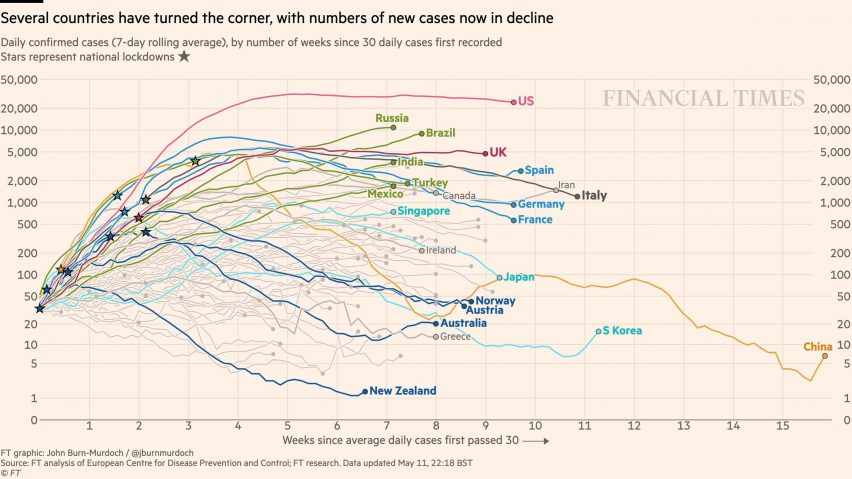

## A pergunta

::: {.citacao .meio .centro}
Quarenta colunas numa planilha.\
Ou um gráfico que explica tudo em cinco segundos.
:::

::: {.fonte .centro}
Qual dos dois muda uma decisão?
:::

::: {.notes}
**0:18** — "Antes de começar, eu queria te fazer uma pergunta. Você já ficou diante de uma planilha com quarenta colunas, tentando descobrir o que aqueles números queriam dizer? E, no sentido contrário: você já viu um único gráfico explicar, em cinco segundos, algo que um relatório inteiro não conseguiu?"
:::

## Dado não é informação {.center}

```{=html}
<div class="fluxo">
  <div class="bloco">
    <span class="tit">DADO</span>
    <span class="sub">689 mil registros</span>
  </div>
  <div class="seta">→</div>
  <div class="bloco">
    <span class="tit">INFORMAÇÃO</span>
    <span class="sub">um padrão visível</span>
  </div>
  <div class="seta">→</div>
  <div class="bloco dest">
    <span class="tit">DECISÃO</span>
    <span class="sub">onde alocar, quando agir</span>
  </div>
</div>
```

```{=html}
<div class="fonte">A visualização é a ponte mais curta entre o dado e a decisão.</div>
```

::: {.notes}
**1:14** — "O SUS produz dados o tempo todo: SINAN, SIH, SIM, e-SUS. Milhões de registros por ano. Só que dado, por si só, não muda a prática de ninguém. O que muda é a informação — e informação é dado com mensagem. Nosso problema não é falta de dado; é a distância entre o dado que temos e a decisão que precisamos tomar."
:::

## Um gráfico, o mundo inteiro entendendo {.center}



```{=html}
<div class="fonte">Burn Murdoch, *Financial Times* (2020) — o mesmo dado das tabelas técnicas, virou compreensão coletiva.</div>
```

::: {.notes}
**1:28** — "Na pandemia de 2020, um gráfico do jornalista de dados John Burn Murdoch, do Financial Times, rodou o mundo. Ele não trazia informação nova: os dados eram públicos. O que ele fez foi organizar as curvas de vários países na mesma escala e com a mesma lógica visual. Qualquer pessoa entendia a dinâmica da pandemia em segundos. E, adianto, aquele gráfico foi feito justamente na ferramenta que vamos usar aqui: o R."
:::

## O que você leva desta aula

```{=html}
<ol class="grande-num">
<li><span class="forte">Princípios</span> que fazem uma figura justificar a sua existência</li>
<li><span class="forte">Componentes</span> fixos e dinâmicos de um gráfico</li>
<li><span class="forte">Canais visuais</span> — linha, ponto, barra, cor, tamanho</li>
<li><span class="forte">Prática</span> — gráficos de mortalidade do SUS no R</li>
</ol>
```

::: {.timeline}
::: {.seg}
**0:00**

Abertura
:::

::: {.seg}
**2:00**

Objetivo
:::

::: {.seg}
**3:00**

Conceitos
:::

::: {.seg}
**7:00**

Aplicações
:::

::: {.seg}
**11:00**

Prática no R
:::

::: {.seg}
**15:00**

Fechamento
:::
:::

::: {.notes}
**2:00** — "Qual é o combinado desta aula? Quatro entregas: princípios, componentes, canais e prática. O ganho prático é direto: ao final você terá um roteiro de decisão para revisar qualquer gráfico do seu relatório e dizer, com segurança, se ele comunica ou se apenas ocupa espaço."
:::

## Os quatro princípios

```{=html}
<div class="cards alto">
  <div class="card t">
    <span class="num">1</span>
    <span class="tit">Justificar a existência</span>
    Se não dá dois parágrafos sobre a figura, ela não precisa existir.
  </div>
  <div class="card t">
    <span class="num">2</span>
    <span class="tit">Direcionar a atenção</span>
    Destaque o que importa: o município, o ano, o grupo fora do esperado.
  </div>
</div>
```

```{=html}
<div class="cards alto">
  <div class="card t">
    <span class="num">3</span>
    <span class="tit">Independência</span>
    Título, subtítulo, eixos e fonte: o gráfico se explica sozinho.
  </div>
  <div class="card t">
    <span class="num">4</span>
    <span class="tit">Reprodutibilidade</span>
    Fonte, período e recorte declarados. Outra pessoa refaz a figura.
  </div>
</div>
```

::: {.notes}
**3:00** — Desenvolva os quatro princípios com um exemplo de cada. "Se eu não consigo escrever dois parágrafos discutindo aquela figura, ela provavelmente não precisa estar no documento. Gráfico decorativo é ruído com moldura."
:::

## Componentes fixos: o esqueleto

::: {.columns}
::: {.column width="58%"}

```{r}
#| label: esqueleto
#| fig-height: 5.8
#| fig-width: 8.8

library(ggplot2)
library(dplyr)
library(readr)
library(scales)

tema_aula <- theme_light(base_size = 15) +
  theme(
    plot.title = element_text(face = "bold", colour = "#1B2A3A"),
    plot.subtitle = element_text(colour = "#5A6B7B", size = rel(0.85)),
    plot.caption = element_text(colour = "#8A99A6", size = rel(0.75), hjust = 0),
    plot.title.position = "plot",
    plot.caption.position = "plot",
    panel.grid.minor = element_blank(),
    axis.text = element_text(colour = "#6B7A88")
  )

ggplot() +
  scale_x_continuous(limits = c(0.5, 12.5), breaks = c(1, 4, 7, 10, 12)) +
  scale_y_continuous(
    limits = c(0, 66000),
    breaks = c(0, 20000, 40000, 60000),
    labels = label_comma(big.mark = ".")
  ) +
  labs(
    x = "Mês do ano",
    y = "Número de óbitos",
    title = "Mortalidade no Rio de Janeiro",
    subtitle = "Óbitos mensais, 2015 a 2019",
    caption = "Fonte: SIM/DataSUS"
  ) +
  tema_aula
```

:::
::: {.column width="42%"}

```{=html}
<ul class="lista-limpa">
<li><span class="forte">Título</span> — a mensagem em até 8 palavras</li>
<li><span class="forte">Subtítulo</span> — recorte, período, amostra</li>
<li><span class="forte">Eixos</span> — o que é medido e em que unidade</li>
<li><span class="forte">Fonte</span> — de onde vieram os dados</li>
</ul>
```

:::
:::

::: {.notes}
**4:58** — "O esqueleto não muda quando entram novos dados. O título é uma simplificação em no máximo oito palavras. O subtítulo é onde o olho técnico pousa: é ali que você diz o recorte, a amostra, a coleta."
:::

## Componentes dinâmicos: as camadas

::: {.columns}
::: {.column width="58%"}

```{r}
#| label: camadas
#| fig-height: 5.8
#| fig-width: 8.8

set.seed(42)
df_ex <- expand.grid(
  mes = 1:12,
  grupo = c("Grupo A", "Grupo B")
) |>
  dplyr::mutate(
    n = round(1200 + 180 * sin(mes / 2) +
      dplyr::if_else(grupo == "Grupo A", 0, 260) +
      stats::rnorm(dplyr::n(), 0, 45))
  )

ggplot(df_ex, aes(x = mes, y = n, colour = grupo)) +
  geom_line(linewidth = 1.1) +
  geom_point(size = 2.2) +
  scale_colour_manual(values = c("Grupo A" = "#008CA6", "Grupo B" = "#1B2A3A")) +
  scale_x_continuous(breaks = 1:12) +
  labs(
    x = "Mês do ano", y = "Número de óbitos",
    title = "Mesmo esqueleto, novas camadas",
    subtitle = "Exemplo ilustrativo",
    caption = "Fonte: elaboração própria",
    colour = NULL
  ) +
  tema_aula +
  theme(legend.position = "top")
```

:::
::: {.column width="42%"}

```{=html}
<ul class="lista-limpa">
<li><span class="forte">Linhas</span></li>
<li><span class="forte">Formas</span></li>
<li><span class="forte">Cores</span></li>
<li><span class="forte">Tamanhos</span></li>
<li><span class="forte">Textos</span> dentro do gráfico</li>
</ul>
```

```{=html}
<p class="pequeno muted">O que muda com os dados: as camadas.<br>
O que não muda: o esqueleto.</p>
```

:::
:::

::: {.notes}
**5:46** — "Os componentes dinâmicos mudam conforme os dados. E aqui está a chave: o ggplot2 foi construído exatamente sobre essa separação. Primeiro o esqueleto, depois as camadas."
:::

## Qual canal para qual dado

```{r}
#| label: canais
#| fig-height: 5.2
#| fig-width: 12

df_serie <- dplyr::tibble(
  mes = 1:12,
  casos = round(cumsum(1200 + 300 * sin(1:12 / 2) + stats::rnorm(12, 0, 80)))
)

p0 <- ggplot(df_serie, aes(x = mes, y = casos)) +
  labs(x = "Mês", y = "Casos acumulados") +
  scale_x_continuous(breaks = c(1, 3, 5, 7, 9, 11)) +
  tema_aula

p_a <- p0 + geom_point(size = 2.4, colour = "#008CA6") + labs(title = "Pontos", subtitle = "observações independentes")
p_b <- p0 + geom_col(fill = "#1B2A3A") + labs(title = "Barras", subtitle = "comparar categorias")
p_c <- p0 + geom_line(linewidth = 1.1, colour = "#008CA6") + labs(title = "Linhas", subtitle = "algo que depende do tempo")

patchwork::wrap_plots(p_a, p_b, p_c)
```

```{=html}
<div class="fonte">Os mesmos dados, três canais. Linhas quando há dependência; pontos quando cada caso é independente; barras quando a variável é categórica.</div>
```

::: {.notes}
**6:05** — "Linhas fazem sentido quando os dados têm dependência entre si — o caso clássico é o tempo. Pontos quando cada observação é independente, como numa dispersão. Barras quando a variável explicativa é uma categoria: dieta, região, equipe, faixa de idade."
:::

## Quando o gráfico tenta dizer tudo

```{r}
#| label: poluido
#| fig-height: 5.6
#| fig-width: 10

ggplot(df_ex, aes(x = mes, y = n)) +
  geom_line(aes(colour = grupo, linetype = grupo), linewidth = 1.1) +
  geom_point(aes(size = n, shape = grupo), colour = "#B03024") +
  scale_colour_manual(values = c("Grupo A" = "#008CA6", "Grupo B" = "#E0B400")) +
  scale_x_continuous(breaks = 1:12) +
  labs(
    x = "Mês", y = "Óbitos",
    title = "Três canais para a mesma informação",
    subtitle = "Cor, forma e tamanho dizendo o mesmo — e nada",
    colour = NULL, shape = NULL, size = "Óbitos",
    caption = "Exemplo ilustrativo"
  ) +
  tema_aula +
  guides(linetype = "none") +
  theme(legend.position = "right", legend.key.size = unit(0.5, "cm"))
```

```{=html}
<p class="pequeno muted">Mais canais não é mais informação. É mais tempo de leitura para a mesma mensagem.</p>
```

::: {.notes}
**6:44** — "Se você colocar cor, formato e tamanho dizendo a mesma coisa, criou três vezes a mensagem e uma leitura confusa. Até um olho treinado gasta dez segundos só para decodificar a legenda. Simplificar é trabalho técnico, não preguiça."
:::

## Os dados: mortalidade no Rio de Janeiro

```{r}
#| label: prep-dados

library(ggplot2)
library(dplyr)
library(readr)
library(scales)

df_sus <- read_rds("../data/SUS-Data-Mortalidade-RJ_2015-2018.rds")

df_mes <- df_sus |>
  group_by(mes = as.integer(format(DTOBITO, "%m"))) |>
  count() |>
  ungroup() |>
  mutate(
    perc_media = (n - mean(n)) / mean(n) * 100,
    # deslocamento só para o mapeamento de tamanho: mantém a ordem
    # (ponto maior = mais óbitos) e a legenda mostra a variação real
    tam_rel = perc_media + 15
  )

idade_mediana <- df_sus |>
  group_by(SEXO) |>
  summarise(mediana = median(idade_obito), n = n())
```

::: {.columns}
::: {.column width="50%"}

```{r}
#| label: tab-variaveis

tibble::tibble(
  Variável = names(df_sus),
  Tipo = vapply(df_sus, function(x) class(x)[1], character(1))
) |>
  knitr::kable()
```

:::
::: {.column width="50%"}

```{=html}
<div class="grande">689.048</div>
```

```{=html}
<p class="pequeno muted">registros de óbito · 6 variáveis · 2015 a 2019</p>
```

```{=html}
<p class="pequeno" style="margin-top:1.2em">Cada linha é um óbito — <span class="forte">formato longo</span>. É assim que o <span class="destaque">ggplot2</span> espera receber os dados.</p>
```

::: {.nota-formato}
**Formato longo** — uma linha por observação. É o que o `ggplot2` consome.

**Formato largo** — uma coluna por mês. Precisa ser convertido antes de plotar.
:::

:::
:::

::: {.notes}
**7:10** — "Base de mortalidade do RJ, 2015 a 2019, baixada com microdatasus: 689.048 registros e seis colunas. É uma tabela no formato longo: cada linha é um óbito. Guarde essa ideia, porque o ggplot2 só trabalha assim."
:::

## Pergunta 1: quando morrem as pessoas?

```{r}
#| label: serie-mes
#| fig-height: 5.9
#| fig-width: 10

ggplot(df_mes, aes(x = mes, y = n)) +
  geom_line(colour = "#008CA6", linewidth = 1.2) +
  geom_point(colour = "#008CA6", size = 2.5) +
  scale_x_continuous(breaks = 1:12) +
  scale_y_continuous(labels = label_comma(big.mark = ".")) +
  labs(
    x = "Mês do ano", y = "Número de óbitos",
    title = "Existe sazonalidade na mortalidade",
    subtitle = "Óbitos por mês do ano · RJ, 2015–2019",
    caption = "Fonte: SIM/DataSUS"
  ) +
  tema_aula
```

```{=html}
<div class="fonte">Maio, junho e julho concentram mais óbitos. Fevereiro — o mês mais curto — fica bem abaixo da média.</div>
```

::: {.notes}
**7:36** — "Primeira pergunta: como a mortalidade se distribui ao longo do ano? Agregamos por mês e plotamos uma linha. Aparece sazonalidade: maio, junho e julho concentram mais óbitos; fevereiro fica bem abaixo da média."
:::

## Pergunta 1: direcionando a atenção

```{r}
#| label: serie-tamanho
#| fig-height: 5.9
#| fig-width: 10

ggplot(df_mes, aes(x = mes, y = n)) +
  geom_line(colour = "#C9D4DC", linewidth = 1.1) +
  geom_point(aes(size = tam_rel), colour = "#008CA6", alpha = 0.85) +
  scale_size(
    range = c(4, 16),
    breaks = c(5, 10, 15, 20),
    labels = function(x) paste0(round(x - 15), "%")
  ) +
  scale_x_continuous(breaks = 1:12) +
  scale_y_continuous(labels = label_comma(big.mark = ".")) +
  labs(
    x = "Mês do ano", y = "Número de óbitos",
    title = "O tamanho do ponto mostra o desvio da média",
    subtitle = "Variação percentual em relação à média mensal · RJ, 2015–2019",
    caption = "Fonte: SIM/DataSUS",
    size = "Variação"
  ) +
  tema_aula
```

::: {.notes}
**8:02** — "Em vez de apenas dizer 'olhe o gráfico', eu mapeio o tamanho do ponto à variação percentual em relação à média. Maio fica grande, fevereiro pequeno. O leitor não precisa comparar alturas: o gráfico já aponta onde olhar. Isso é uma decisão de comunicação que qualquer gestor pode tomar."
:::

## Pergunta 2: a distribuição é igual entre os sexos?

```{r}
#| label: densidade
#| fig-height: 5.9
#| fig-width: 10

ggplot(df_sus, aes(x = idade_obito, colour = SEXO)) +
  geom_density(linewidth = 1.2) +
  scale_colour_manual(values = c("Feminino" = "#008CA6", "Masculino" = "#1B2A3A")) +
  coord_cartesian(xlim = c(0, 100)) +
  labs(
    x = "Idade do óbito", y = "Densidade",
    title = "Homens morrem mais cedo",
    subtitle = "Distribuição da idade do óbito por sexo · RJ, 2015–2019",
    caption = "Fonte: SIM/DataSUS",
    colour = NULL
  ) +
  tema_aula +
  theme(legend.position = "top")
```

::: {.notes}
**8:30** — "Trocamos a linha por densidade e usamos a cor para separar os sexos. O resultado é forte: os homens morrem mais cedo, com um pico importante na juventude — violência e causas externas —, enquanto a curva feminina se desloca para idades mais avançadas."
:::

## Pergunta 2: a mesma mensagem em quartis

```{r}
#| label: boxplot-sexo
#| fig-height: 5.4
#| fig-width: 9

ggplot(df_sus, aes(x = SEXO, y = idade_obito, fill = SEXO)) +
  geom_boxplot(width = 0.45, outlier.size = 0.6, outlier.alpha = 0.3) +
  scale_fill_manual(values = c("Feminino" = "#BEE3EA", "Masculino" = "#C9D4DC")) +
  coord_cartesian(ylim = c(0, 100)) +
  labs(
    x = NULL, y = "Idade do óbito",
    title = "Idade mediana ao morrer",
    subtitle = "Boxplot por sexo · RJ, 2015–2019",
    caption = "Fonte: SIM/DataSUS"
  ) +
  tema_aula +
  theme(legend.position = "none")
```

```{=html}
<p class="pequeno">Mediana de <span class="destaque">`r round(idade_mediana$mediana[idade_mediana$SEXO == "Feminino"])` anos</span> entre as mulheres e <span class="destaque">`r round(idade_mediana$mediana[idade_mediana$SEXO == "Masculino"])` anos</span> entre os homens — uma diferença de `r round(idade_mediana$mediana[idade_mediana$SEXO == "Feminino"] - idade_mediana$mediana[idade_mediana$SEXO == "Masculino"])` anos.</p>
```

::: {.notes}
**8:54** — "O boxplot entrega a mesma mensagem de forma mais compacta: a mediana feminina fica perto dos 75 anos; a masculina, perto dos 66. Nove anos de diferença, visíveis em um único gráfico."
:::

## Pergunta 3: o padrão se repete nos dois grupos?

```{r}
#| label: facetas
#| fig-height: 5.4
#| fig-width: 11

df_mes_sexo <- df_sus |>
  group_by(SEXO, mes = as.integer(format(DTOBITO, "%m"))) |>
  count() |>
  ungroup() |>
  group_by(SEXO) |>
  mutate(perc_media = (n - mean(n)) / mean(n) * 100,
         tam_rel = perc_media + 15) |>
  ungroup()

ggplot(df_mes_sexo, aes(x = mes, y = n)) +
  geom_line(colour = "#C9D4DC", linewidth = 1) +
  geom_point(aes(size = tam_rel), colour = "#008CA6", alpha = 0.85) +
  scale_size(range = c(3, 10), guide = "none") +
  scale_x_continuous(breaks = c(1, 6, 12)) +
  scale_y_continuous(labels = label_comma(big.mark = ".")) +
  labs(
    x = "Mês do ano", y = "Óbitos",
    title = "A sazonalidade se repete nos dois sexos",
    subtitle = "Óbitos por mês, por sexo · RJ, 2015–2019",
    caption = "Fonte: SIM/DataSUS"
  ) +
  tema_aula +
  facet_wrap(~SEXO)
```

::: {.notes}
**9:10** — "Em vez de dois gráficos separados, com risco de escalas diferentes, usamos facetas: uma linha de código replica o gráfico por grupo, com a mesma escala. E a comparação mostra que a forma da sazonalidade é praticamente a mesma nos dois grupos — o que muda é a magnitude."
:::

## Três gráficos, três decisões

```{=html}
<div class="cards painel">
  <div class="card t">
    <span class="tit">QUANDO</span>
    Alocar recursos no ano?<br>
    <span class="muted pequeno">Picos em maio, junho e julho</span>
  </div>
  <div class="card t">
    <span class="tit">PARA QUEM</span>
    Priorizar prevenção?<br>
    <span class="muted pequeno">Homens morrem 9 anos mais cedo</span>
  </div>
  <div class="card t">
    <span class="tit">ONDE</span>
    Agir primeiro?<br>
    <span class="muted pequeno">Recorte por município ou regional</span>
  </div>
</div>
```

<hr class="linha">

```{=html}
<p class="pequeno">Cada figura responde a <span class="forte">uma</span> pergunta. Se você não sabe qual, volte ao princípio nº 1 — e considere retirá-la.</p>
```

::: {.notes}
**9:38** — "Pare um segundo e pense no que acabamos de fazer. Em três gráficos, respondemos a três perguntas de gestão. Não é sobre gráficos bonitos: é sobre encurtar o caminho entre o dado e a decisão."
:::

## A lógica do ggplot2

::: {.columns}
::: {.column width="56%"}

```r
ggplot(data = df_mes, aes(x = mes, y = n)) +
  geom_line() +
  geom_point() +
  labs(
    title    = "Existe sazonalidade na mortalidade",
    subtitle = "Óbitos por mês do ano · RJ, 2015–2019",
    x = "Mês do ano",
    y = "Número de óbitos",
    caption  = "Fonte: SIM/DataSUS"
  ) +
  theme_light()
```

:::
::: {.column width="44%"}

```{r}
#| label: codigo-saida
#| fig-height: 4.8
#| fig-width: 7

ggplot(df_mes, aes(x = mes, y = n)) +
  geom_line(colour = "#008CA6", linewidth = 1.1) +
  geom_point(colour = "#008CA6", size = 2) +
  scale_x_continuous(breaks = c(1, 4, 8, 12)) +
  scale_y_continuous(labels = label_comma(big.mark = ".")) +
  labs(
    x = "Mês do ano", y = "Óbitos",
    title = "O resultado",
    subtitle = "RJ, 2015–2019",
    caption = "Fonte: SIM/DataSUS"
  ) +
  tema_aula
```

:::
:::

```{=html}
<div class="cards">
  <div class="card n"><span class="tit">ggplot()</span>cria a tela vazia — o esqueleto</div>
  <div class="card n"><span class="tit">aes()</span>mapeia colunas em canais</div>
  <div class="card n"><span class="tit">+</span>adiciona camadas</div>
  <div class="card n"><span class="tit">labs()</span>dá nome a tudo</div>
</div>
```

::: {.notes}
**11:00** — "Atenção à lógica, não à decoreba. Três movimentos: carregar o pacote, criar a tela vazia, exibir. Depois aes() mapeia colunas em canais; o sinal de mais adiciona camadas; labs() aplica o princípio da independência. E o tema é figurino: o dado é o ator."
:::

## Cinco perguntas antes de publicar

```{=html}
<ol class="grande-num">
<li>Qual pergunta este gráfico responde?</li>
<li>O título diz <span class="forte">o quê, onde e quando</span>?</li>
<li>O subtítulo traz o recorte e a amostra?</li>
<li>Os canais visuais são os mais intuitivos para esse dado?</li>
<li>A fonte está indicada e o arquivo tem nome padronizado?</li>
</ol>
```

```{=html}
<div class="fonte">Cinco "sim" — o gráfico está pronto para sair do seu computador.</div>
```

::: {.notes}
**14:14** — "Este é o checklist que eu uso. Se as cinco respostas forem sim, o gráfico está pronto. Se alguma for não, você já sabe onde mexer."
:::

## O que fica

::: {.columns}
::: {.column width="52%"}

```{=html}
<ul class="lista-limpa">
<li><span class="forte">A razão da análise é a comunicação.</span><br><span class="pequeno muted">Relatório que ninguém entende tem impacto zero.</span></li>
<li><span class="forte">Uma figura precisa justificar a sua existência.</span><br><span class="pequeno muted">Quatro princípios, menos gráficos, mais força.</span></li>
<li><span class="forte">A ferramenta é acessível.</span><br><span class="pequeno muted">DataSUS + ggplot2 + três camadas de código.</span></li>
</ul>
```

:::
::: {.column width="48%"}

```{=html}
<h3>Para continuar</h3>
```

```{=html}
<p class="pequeno">
<strong>ggplot2-book.org</strong><br>
Wickham, *ggplot2: Elegant Graphics for Data Analysis*<br><br>
<strong>dados.gov.br</strong><br>
Portal Brasileiro de Dados Abertos<br><br>
<strong>datasus.saude.gov.br</strong><br>
Bases do SUS · pacote `microdatasus`
</p>
```

:::
:::

::: {.notes}
**15:00** — "Três ideias: comunicação é a razão da análise; a figura precisa justificar a existência; a ferramenta é acessível. Para continuar: o livro do Wickham, o portal de dados abertos e o DataSUS."
:::

## Qual gráfico você vai refazer esta semana?

::: {.citacao .meio .centro}
Escolha um gráfico.\
**Um só.**
:::

::: {.fonte .centro}
É assim que a cultura de avaliação sai do papel.
:::

::: {.notes}
**16:47** — "Fica o convite: qual gráfico você vai refazer esta semana? Escreva a resposta antes de fechar este vídeo. Obrigado por acompanhar — até a próxima aula."
:::
